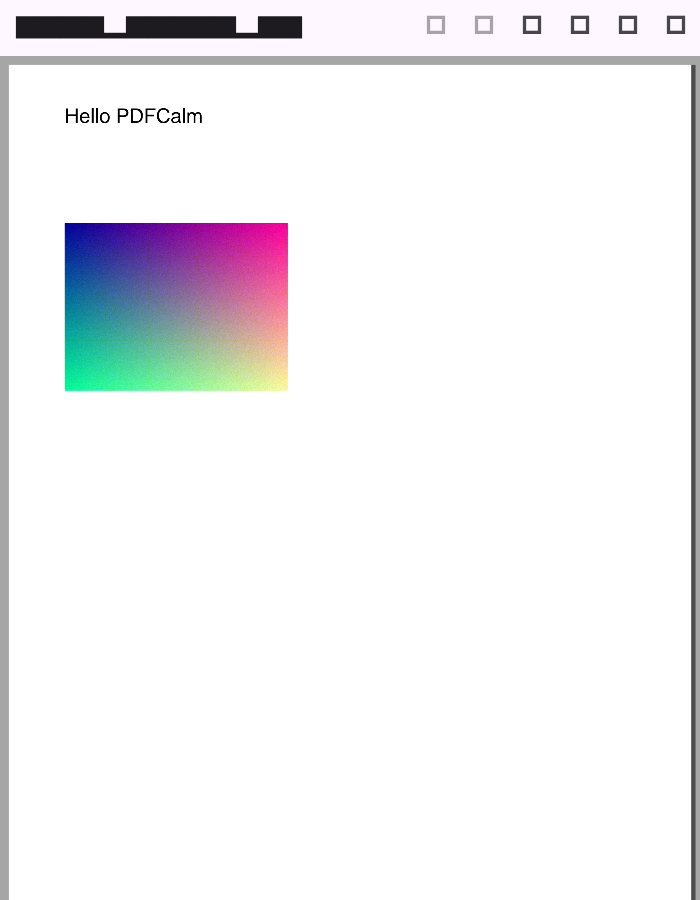
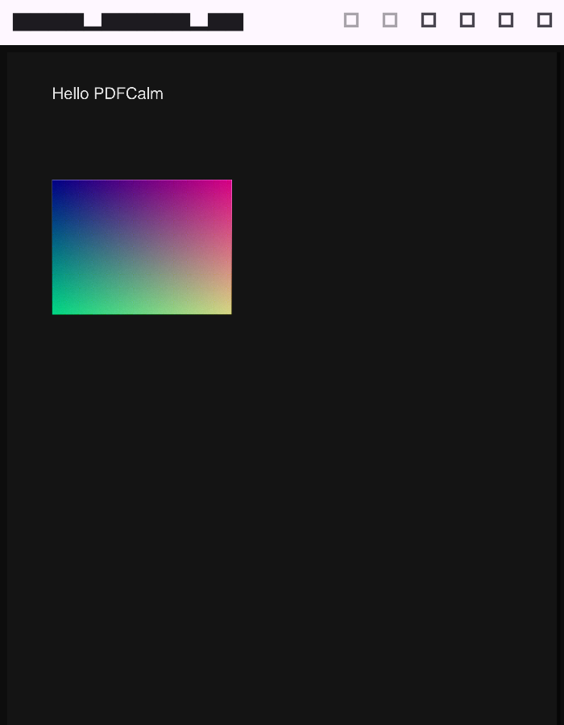
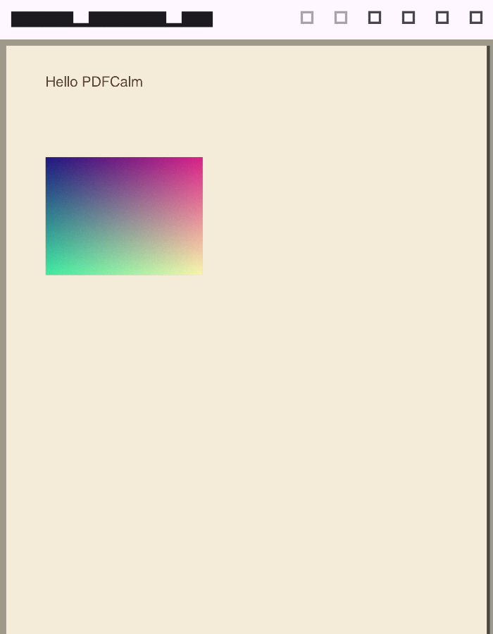
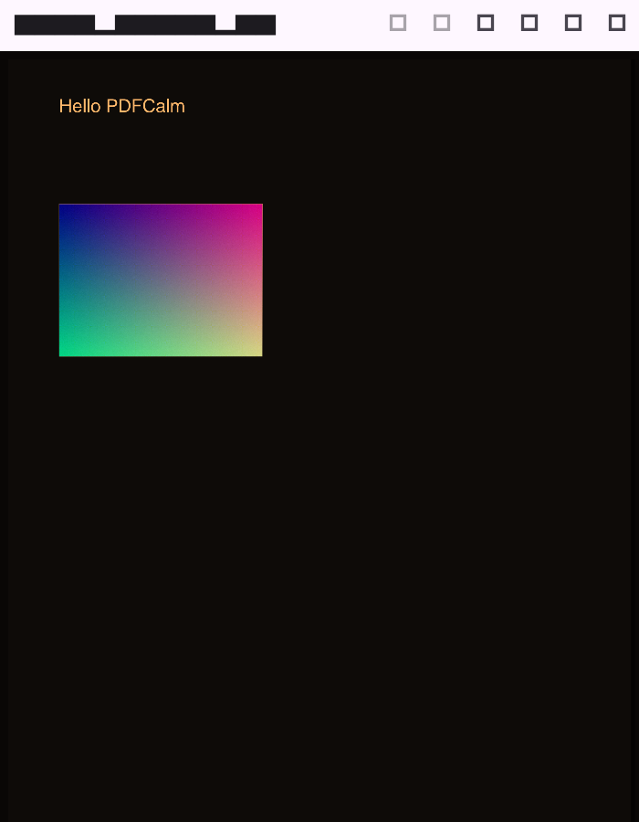
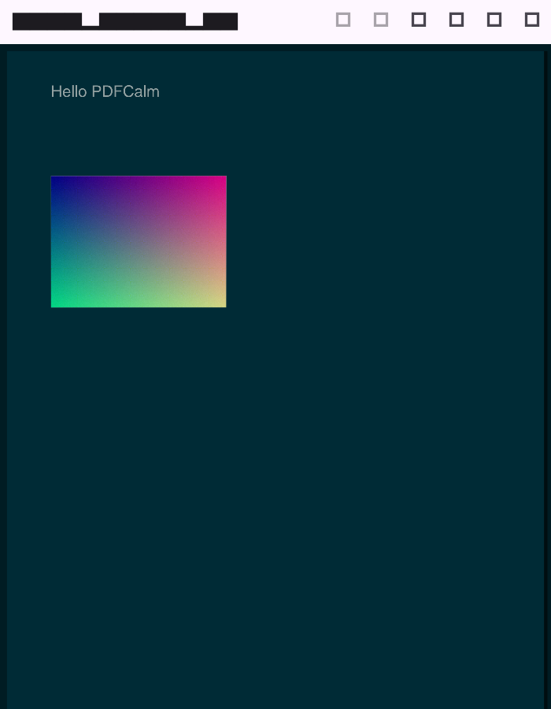

# PDFCalm

A lightweight, offline PDF viewer and editor built around **eye comfort**. Read for hours in a dark, sepia or amber view that keeps pictures looking like pictures, and do the everyday PDF jobs (merge, split, compress, fill, sign) without uploading anything to a website.

> This repository only hosts **downloads and release notes**. Get the latest build from the [Releases page](../../releases/latest).

## Download

| Platform | File | Notes |
|---|---|---|
| macOS (Apple silicon / Intel) | `PDFCalm-<version>-macos.dmg` | Open the dmg, drag PDFCalm to Applications. The app is not notarized: the first time, **right-click → Open**. |
| Android (most phones) | `PDFCalm-<version>-arm64-v8a.apk` | Allow "install unknown apps" for your browser/file manager. |
| Android (older 32-bit phones) | `PDFCalm-<version>-armeabi-v7a.apk` | |
| Android (emulators / Chromebooks) | `PDFCalm-<version>-x86_64.apk` | |

The Android builds are debug-signed, so they are meant for sideloading, not the Play Store.

**Updates:** the app checks this repository about once a day and offers to download new versions. You can also use **Check for updates…** in the home screen menu. Nothing else ever leaves your device.

## Eye-comfort reading modes

Switch modes from the reading-mode button. Your last choice is remembered on every platform and applied the next time you open any document.

| Mode | What it does |
|---|---|
| Normal | The document as authored. |
| Dark (smart) | Inverts the page to a soft near-black with light text. Photos are kept in their natural colours, only slightly dimmed. |
| Dark (grey) | Greyscale dark, for text-heavy documents. |
| Sepia | Warm, paper-like tint. |
| Night amber | Dark page with amber text, to reduce blue light at night. |
| Solarized light / dark | The classic low-contrast palettes. |
| Soft paper | Off-white background, near-black ink. |
| Custom | Pick your own paper and ink colours. |

On top of any mode you can adjust **brightness, contrast, warmth and saturation**, choose how images are treated, and tell the app whether a document is a **scan** (so scanned pages are darkened like text) or **photos** (kept natural).

  
  

## Reading

- Continuous scroll, single page, horizontal scroll, two pages, and two pages with the cover alone.
- Search, contents / outline, and go-to-page.
- Password-protected PDFs (enter the password to open; unlock to save an unprotected copy).
- Remembers the page and reading mode per document, and keeps a recent-files list.
- Keyboard shortcuts on macOS.

## Editing and tools

- **Organize pages:** reorder, rotate, duplicate, delete, insert pages from another PDF, extract pages.
- **Merge** several PDFs, **split** by range, **images → PDF**, **PDF → PNG**.
- **Compress** with Balanced or Strong presets, optional greyscale. The result is never larger than the original, and it can be cancelled.
- **Crop margins**, **redact text** (the page is rasterized so the text is truly gone), **watermark**, **page numbers**, whiteout.
- **Mark up & sign:** pen, highlighter, typed text, and hand-drawn signatures saved on your device.
- **Fill forms:** text fields, check boxes, radio buttons, drop-downs and lists; optional flatten.
- **Undo / redo** for every edit. Edits happen on a working copy and are written with a verified, atomic save, so a failed save cannot damage your original. "Save a copy" is always available.

## Android specifics

- Works on **foldable phones**: switching between the cover and inner screen keeps you on the same page.
- Tap the **top-left corner** of the document to cycle through the reading modes without opening any menu.

## Privacy

PDFCalm works entirely offline. Documents are never uploaded. The only network request is the update check, which asks this repository for the latest release number.

## Requirements

- macOS 11 or later.
- Android 7.0 (API 24) or later.

## Known limitations

- The macOS app is ad-hoc signed (right-click → Open on first launch); Android APKs are debug-signed.
- Not yet available: password protection/encryption, OCR, metadata editing, digital (certificate) signatures, creating new form fields, a thumbnail sidebar, iOS/Windows/Linux builds.
- Updates are downloaded and installed by you; the app does not replace itself.

## Feedback

Please open an [issue](../../issues) with the version number (shown on the release you installed), your device, and what happened.
